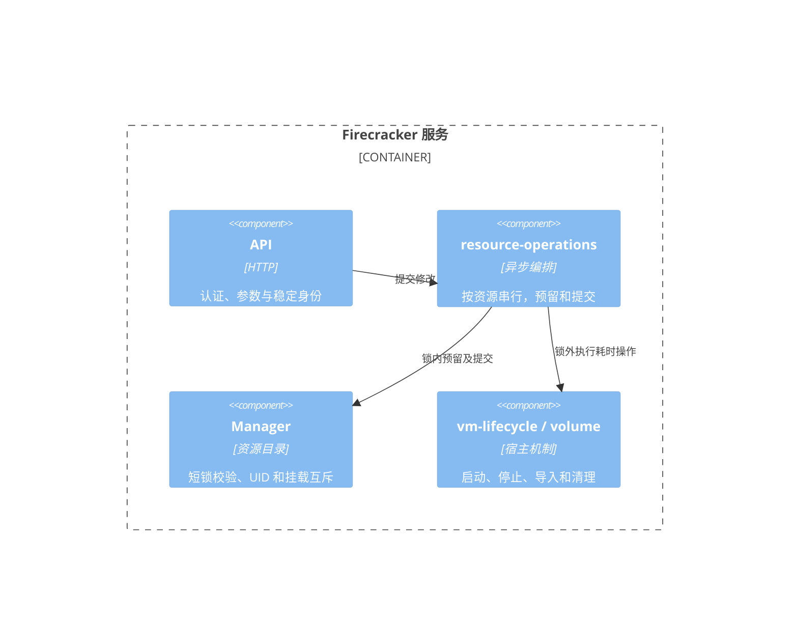

# Firecracker isolation server

独立的 Linux / Rust 服务，为 Codex、Claude Code、DSH、OpenCode 等原生运行时提供 microVM 隔离机制。它不实现模型协议、不自动批准工具调用；运行时安装与启动命令由可信 guest 镜像决定。现有 mindos-node 的 harness driver 不受修改。

## 边界与接口

服务只监听 loopback HTTP，所有接口均要求 `Authorization: Bearer <key>`；带浏览器 Origin 的请求被拒绝。远程使用 SSH 隧道或可信 TLS 网关。一个服务实例对应一个管理员信任域，API key 具有管理该实例全部 VM/卷的权限，不提供多租户身份隔离。

| 接口 | 行为 |
| --- | --- |
| `GET /v1/health` | 服务身份和版本 |
| `GET /v1/profiles` | 可用资源配置、端口及目录绑定，不返回宿主路径 |
| `POST /v1/volumes` | `{ "id": "project-main", "binding": "project" }`，把已授权目录导入 ext4 卷 |
| `GET /v1/volumes` | 持久卷及占用状态 |
| `GET /v1/volumes/:id/disk` | 流式导出未挂载的 ext4 镜像；下载期间禁止挂载或删除 |
| `DELETE /v1/volumes/:id` | 删除未挂载的持久卷 |
| `POST /v1/vms` | `{ "id": "run-1", "profile": "debian13", "volumes": ["codex-main"], "directories": ["project"] }`；两种挂载均可省略 |
| `GET /v1/vms`、`GET /v1/vms/:id` | VMM 状态、profile、卷及运行时长 |
| `DELETE /v1/vms/:id` | 关闭 guest、回收 VMM 与 jail/cgroup，保留目录卷；返回 `{id,stopped,mode}` |
| `POST /v1/vms/:id/connect/:port` | HTTP/1.1 Upgrade `mindos-vsock`，升级为双向字节流 |

调用方不能提交宿主路径、命令、镜像路径、内存、网络或 jailer 参数。创建使用调用方稳定 ID；同 ID 同参数重复调用返回现有资源，不创建副本；同 ID 不同参数返回 409。修改任务在客户端断开后继续完成，超时后先按原 ID 查询。VM 的幂等记录仅存在于当前服务进程，不承诺跨崩溃 exactly-once。

`state=vmm-running` 只说明 Firecracker 已启动，不表示 Debian 或 harness 已就绪。`guestReady=false` 明确保留这个区别；客户端在 guest 服务启动后才能建立相应端口连接。

## 并发与资源生命周期

同 VM 或卷的修改按稳定资源 ID 串行。全局目录锁只负责校验、资源预留和提交结果；导入、启动、停止、删除和导出文件打开在锁外执行，因此慢卷导入不阻塞其他 VM 的查询或停止。启动和停止期间仍预留 UID、目录及块卷，查询返回 `starting` / `stopping`；这些状态不可建立隧道。失败停止保留 VM 所有权以供重试，失败清理保留预留以防 UID 或挂载被复用。关闭先拒绝新建，等待已预留的启动和导入，并回收 VM；中止定期回收循环不会取消已经持有 VM 的清理任务。



## Debian 13 镜像

构建需要 Docker、sudo 和 e2fsprogs。构建过程导出 Debian 13 容器用户态，使用 `mkfs.ext4 -d` 生成镜像，不把 guest 文件系统挂载到宿主内核。内核单独提供，必须支持 Firecracker virtio-blk、virtio-vsock、ext4、devtmpfs，以及 systemd 所需的 cgroups、namespaces 等功能；根盘驱动需编入内核，不能依赖本镜像未提供的 initramfs。virtio-fs 模式还需内建 `CONFIG_FUSE_FS`、`CONFIG_VIRTIO_FS`、`CONFIG_VIRTIO_MMIO_CMDLINE_DEVICES`。

```bash
bash scripts/build-debian13.sh /path/to/debian13.ext4 4096
cargo build --release --locked
sudo install -m 0755 target/release/firecracker-server /usr/local/bin/firecracker-server
sudo install -d -m 0700 /var/lib/mindos-firecracker /var/lib/mindos-images /etc/mindos-firecracker
sudo install -m 0644 /path/to/vmlinux /var/lib/mindos-images/vmlinux
sudo install -m 0600 /path/to/debian13.ext4 /var/lib/mindos-images/debian13.ext4
sudo install -m 0600 config.example.toml /etc/mindos-firecracker/config.toml
```

下载较慢时可通过 `DEBIAN_MIRROR` 和 `DEBIAN_SECURITY_MIRROR` 选择可访问的 Debian 镜像；APT 的签名验证保持启用。镜像中的 DNS 链接在容器导出后建立，避免修改 Docker 管理的 resolv.conf 挂载点。

构建临时目录默认放在 `/var/tmp`，可用 `TMPDIR` 覆盖。导出后删除 Docker 容器标记，确保 systemd 按 KVM guest 执行卸载/落盘。CtrlAltDel 使用正常 reboot 流程和 `reboot=k` 触发 Firecracker 退出；在本配置的 `acpi=off` 下，poweroff 会停在内核 halt，不能据此判定 VMM 已退出。

编辑配置中的目录 source，提前创建源目录；目录中文件 UID/GID 保留，guest 的 `agent` 为 1000:1000。权限不匹配时应在可信源中准备正确权限，而不是放宽宿主访问。构建脚本跟随 Debian 13 的更新标签，不宣称镜像位级可复现；需要固定制品时记录基础镜像 digest、包版本和产物 SHA-256。

基础镜像提供 7000 端口的非 root Bash 字节流，用于验证和通用命令执行。生产镜像应按需安装运行时，将固定入口写入 `/usr/local/libexec/harness-PORT`，启用 `harness-vsock@PORT.service`，再在 profile 中授权该端口。运行时参数和凭据由可信镜像/配置卷管理，不从 VMM 管理 API 透传任意宿主执行。

例如安装 Codex 的派生镜像可使用如下固定入口：

```sh
#!/bin/sh
export CODEX_HOME=/home/agent/.codex
cd /workspace/project
exec /usr/local/bin/codex app-server
```

这是 guest 的 stdio 服务；外部 client 使用 `connect` 传输其原生 JSON-RPC。Claude Code、DSH、OpenCode 依照各自原生服务协议配置独立端口，核心服务没有按工具名称分支。当前尚未修改 mindos-node driver 的进程启动方式；需要接入其现有项目沙箱时，应另做 launcher 适配，不能把这个通道视为已有完整 harness 会话适配器。

## 启动与目录挂载

宿主需要可访问的 `/dev/kvm`、匹配版本的静态 Firecracker/jailer、可用的 cgroup v2 memory/cpu/pids controller、bubblewrap 和 e2fsprogs。目录导入在 bubblewrap 的文件系统/网络命名空间内执行，避免源目录符号链接指向宿主其他私有目录；不能启用隔离时导入失败，不回退到宿主直接读取。

服务、配置、镜像、jailer、state_dir 及其父目录必须 root 所有且不可由 group/other 写入，路径必须是规范绝对路径且不含符号链接。`uid_base` 开始的 `max_vms` 个 UID/GID 必须专供本服务，不可用于宿主账号或其他服务。

```bash
# Generate a private >=32-character key, and provide it through the environment.
export FIRECRACKER_API_KEY='<private-random-key>'
sudo --preserve-env=FIRECRACKER_API_KEY /usr/local/bin/firecracker-server serve /etc/mindos-firecracker/config.toml
```

长期运行可使用提供的 systemd unit。将密钥放在 root:root 0600 的 `/etc/mindos-firecracker/environment`，以 `FIRECRACKER_API_KEY=...` 配置；`KillMode=control-group` 提供额外的进程回收边界。

```bash
curl -fsS -H "Authorization: Bearer $FIRECRACKER_API_KEY" \
  -H 'Content-Type: application/json' http://127.0.0.1:8790/v1/volumes \
  -d '{"id":"project-main","binding":"project"}'
curl -fsS -H "Authorization: Bearer $FIRECRACKER_API_KEY" \
  -H 'Content-Type: application/json' http://127.0.0.1:8790/v1/volumes \
  -d '{"id":"codex-main","binding":"codex"}'
curl -fsS -H "Authorization: Bearer $FIRECRACKER_API_KEY" \
  -H 'Content-Type: application/json' http://127.0.0.1:8790/v1/vms \
  -d '{"id":"run-1","profile":"debian13","volumes":["project-main","codex-main"]}'
printf 'cat /etc/os-release; id; exit\n' | firecracker-server connect http://127.0.0.1:8790 run-1 7000
curl -fsS -X DELETE -H "Authorization: Bearer $FIRECRACKER_API_KEY" \
  http://127.0.0.1:8790/v1/vms/run-1
```

`backend = "block"`（默认）采用 **virtio-blk**：第一次导入复制文件，之后直接复用同一 ext4 镜像。它不提供宿主 bind mount，也不是实时共享文件系统。运行中的卷独占挂载；只读绑定同时设置 Firecracker `is_read_only` 和 guest `ro,nodev,nosuid`。guest 的 session、配置或项目修改保留在卷中，不会自动写回原 source。rootfs 本身是每次启动的新副本，需要保留的数据应放在目录卷或直通目录中。

guest/宿主同时写同一 ext4 镜像会损坏文件系统，禁止在宿主挂载正在运行的卷。导出镜像可能含 guest 控制的文件系统数据和凭据；应作为私有制品保存，不自动以 root 挂载或解包回宿主。

Firecracker 的宿主 UDS EOF 会关闭 vsock 两个方向，不能据此保留远端最后的输出。CLI 在 stdin 结束后保留连接，等待 guest 关闭；Bash 批处理应显式 `exit`，其他协议使用自身的结束消息。终止 client 进程仍会断开通道，不会自动删除 VM。

## virtio-fs 目录直通

这是已实现的实验性 Firecracker 分支能力，标准上游二进制不能使用。首版每台 VM 最多一个 virtio-fs 目录，可同时附加多个 block 卷；不支持 DAX、快照恢复、热插拔或 backend 重连。多个独立目录需要分别授权：可以把项目设为直通、配置/session 设为持久块卷，或使用管理员专门准备的单一会话目录树，不能为绕过限制而扩大到整个 HOME。

仓库包含固定基线的 [VMM 补丁](patches/firecracker-virtiofs.patch) 和重建入口；无需依赖本机的外部 worktree：

```bash
bash scripts/prepare-firecracker-virtiofs.sh /path/to/new-firecracker-source
cd /path/to/new-firecracker-source
cargo build --locked --release --target x86_64-unknown-linux-musl -p firecracker -p jailer
```

基线是 `edb60617c31ebd610c530f67706ec5c79d4c2725`，对应本次实现提交 `b3795fb9dfeff3dc9ab9b526f81827ab9480bd06`。依赖遵循该基线的 Rust toolchain 和 musl 构建要求；Debian 宿主若缺少 `linux/types.h`，可设置 `CFLAGS_x86_64_unknown_linux_musl="-idirafter /usr/include -idirafter /usr/include/x86_64-linux-gnu"`。使用 `build/cargo_target/x86_64-unknown-linux-musl/release/` 下的 firecracker/jailer；GNU debug 构建不能替代默认 seccomp 验收。补丁内的 `tools/virtiofs/build-kernel.sh` 可在新输出目录构建 guest 内核。

参考 [直通配置](config.virtiofs.example.toml)，安装可信 Rust virtiofsd（已验证 1.14.0，必须支持 `--readonly`）。宿主还需 Linux 5.14+ 的 `openat2/open_tree/move_mount/mount_setattr/cgroup.kill`、mount/PID/network namespaces 和 bubblewrap；不支持这些边界时创建失败。服务仍需要 root，daemon 对绑定内部按 guest UID/GID 操作；可写授权包含 guest 对该目录的修改能力，不是凭据保密边界。

```toml
# Global setting, before any TOML table.
virtiofsd = "/usr/libexec/virtiofsd"

[bindings.project]
backend = "virtiofs"
source = "/srv/harness/project"
target = "/workspace/project"
read_only = false
```

将 `project` 加入 profile 的 `bindings`，然后直接创建 VM，无需创建或导入该目录的 volume：

```bash
curl -fsS -H "Authorization: Bearer $FIRECRACKER_API_KEY" \
  -H 'Content-Type: application/json' http://127.0.0.1:8790/v1/vms \
  -d '{"id":"run-live","profile":"debian13","directories":["project"]}'
```

文件仍是宿主目录里的普通文件。`cache=never` 不启用 writeback；正常文件读写无需先转换镜像或另外调用同步 API。文件系统共享不提供应用事务、双向冲突合并或断电持久性保证，运行时仍需按自己的协议 flush/fsync，session 保持单一写入方。

源目录通过无符号链接的目录 FD 固定，非递归 mount clone 排除宿主子挂载；只在 supervisor 私有挂载命名空间中挂接。每台 VM 使用独立 virtiofsd、私有 socket、namespace sandbox、seccomp 和 cgroup。只读授权同时施加只读宿主挂载及 daemon `--readonly`，guest root remount 为 rw 也不能绕过。禁用 inode file handles，daemon 无 `DAC_READ_SEARCH`；导出树中的既有硬链接同样属于已授权 inode，宿主移动文件也不等于撤销 guest 已打开的句柄。

活动直通目录互斥，普通不重叠目录可并行使用。同一文件系统的不同 mount ID 保守互斥，以覆盖直接 bind 子目录形成的别名；不能据此假设所有宿主应用都受此锁约束。daemon 能访问所属 VM 的共享 RAM，应视为该 VM 的受信任组件，不跨 VM 复用。

## 网络、回收与诊断

默认无网卡。需要访问 LLM 网关时，管理员预先配置 TAP、netns、DHCP/DNS 和防火墙，再通过 `profile.network_slots` 指定。数组按全局 UID 槽位索引，需覆盖 `max_vms` 个槽位；不同 profile 也应为同一槽位选择相容的预置网络。服务不创建 NAT、不自动开放宿主网段或 metadata endpoint。每个槽位的网卡限制应由对应 netns 的防火墙明确实施。

资源受 vCPU、guest RAM、cgroup CPU/memory/pids、连接数和最大存活时间限制。根盘和卷是固定大小；整体镜像复制仍占宿主磁盘，生产部署应另配 state_dir 的文件系统配额。服务不会禁用默认 seccomp，也不允许绕过 jailer。关闭优先发送 CtrlAltDel，Debian 将其映射到正常 reboot 并让 VMM 退出；超过期限后强制停止并记录 `GUEST_SHUTDOWN_UNCONFIRMED`，强停后不能承诺尚未落盘的数据。

关闭结果的 `mode` 明确区分 `guest-shutdown`、`forced`、`already-exited` 和 `absent`。调用方不能把强制回收成功解释为 guest 已完成落盘。x86 guest 内核需要编入 i8042/AT keyboard 支持才能响应 CtrlAltDel；缺少该支持时将触发有界强停。

特权 supervisor 独立于 jailer 的降权过程，接收服务父进程死亡信号后杀死并回收 VMM。目录 backend 使用单独的 supervisor/cgroup；镜像复制、daemon socket 等待和 VMM 启动共享启动期限。helper 退出不等于整棵进程树退出，回收还检查 `cgroup.events`，必要时 `cgroup.kill` 并等待空组。普通退出清理 jail 和 cgroup，保留卷。异常退出可能留下 jail/cgroup；下次启动拒绝接管未知进程，管理员应先确认对应 cgroup 无进程，再删除遗留 jail 和空 cgroup，不能删除 `volumes/` 来绕过检查。

stderr 提供 JSON 诊断，包含 operation_id、阶段、结果、错误分类和操作耗时，I/O 失败额外提供 errno。不会记录原生 stdio 正文、文件正文或 API key。创建失败时核对 jailer/cgroup/KVM 运行条件；HTTP 错误提供 error、stage、operationId，HTTP 200 不代表 guest 中的业务执行成功。

## 同步与验证

首次目录导入和停止后的镜像导出属于快照传递，当前不具备文件级增量同步或双向冲突合并。配置/凭据适合显式单向投递；session 应保持单一写入方，不应在原生运行时写入期间覆盖其文件。

仓库的 [mindos-node sync](../mindos-node/doc/sync.md) 提供版本化对象存储、条件发布和持久回执，可作为后续同步后端；它仍需要负责 guest/宿主扫描、基线和应用文件的客户端。vsock 通道可以承载该客户端协议，但 VMM 服务不会据此宣称自动完成目录同步。

```bash
cargo fmt --check
cargo clippy --all-targets -- -D warnings
cargo test --locked
```

测试覆盖认证、Origin 拒绝、策略/路径注入、目录授权/占用、只读块设备、vsock 有界握手与 stdin EOF、真实 ext4 导入/重新加载。真实 Debian/KVM 验收使用 `scripts/smoke.py SERVER KERNEL IMAGE`；直通验收使用 `scripts/smoke-virtiofs.py SERVER KERNEL IMAGE FORK_FIRECRACKER FORK_JAILER VIRTIOFSD`。脚本要求免交互 sudo，只操作临时目录，失败不跳过；直通脚本仅在一次性镜像副本注入 root 测试端口，验证 guest remount 不能突破宿主只读授权。结果和限制见 [验收记录](VALIDATION.md)。

实现依据：[Firecracker jailer](https://github.com/firecracker-microvm/firecracker/blob/main/docs/jailer.md)、[vsock 协议](https://github.com/firecracker-microvm/firecracker/blob/main/docs/vsock.md)、[生产宿主隔离要求](https://github.com/firecracker-microvm/firecracker/blob/main/docs/prod-host-setup.md)、[Debian 13](https://www.debian.org/releases/trixie/)。
